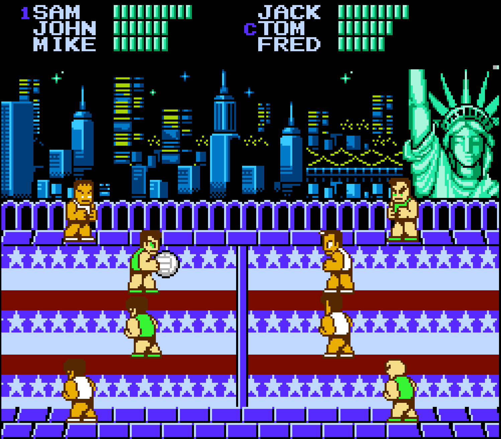

# Super Dodge Ball Recomp

**Super Dodge Ball** (NES, 1989, Technōs Japan) recompiled to native C and running on your PC.

Not an emulator. The cartridge's 6502 machine code is translated to C at build time and executed natively against a cycle-accurate model of the console. It boots, it plays, and its memory state is byte-for-byte identical to an accurate emulator's from power-on through team select.

You bring the ROM. Nothing from the cartridge ships here.



| | |
|---|---|
| **Playable** | title, menus, team select, and full matches end to end — throws land, damage numbers show, HUD and menus render |
| **Verified against** | MesenCE 2.2.1 — 400 frames of RAM, OAM, palette and CIRAM byte-exact from boot · blargg CPU suite 25/25 |
| **Mods** | 3, all **off by default** — flicker removal, widescreen with margin sprites, PPU overclocking |
| **Engine patches** | 0 — the three this port carried are upstream now (PRs #66, #67, #69) |
| **Open bugs** | 2, both in the flicker mod's presentation layer |

Built with [NESRecomp](https://github.com/mstan/nesrecomp) by Matthew Stanley — framework questions belong upstream, game-specific issues belong [here](https://github.com/saftle/Super-Dodge-Ball-Recomp/issues). **This port is in active development; expect rough edges.**

> **Fan project.** Unaffiliated with and not endorsed by any rights holder — see
> [Legal and project notices](#legal-and-project-notices). No game content is
> included; you supply your own legally obtained ROM. Built with substantial AI
> assistance — see the [AI disclosure](#ai-disclosure).

---

# Playing

## Quick start

```bash
# 1. Drop your legally obtained ROM here:
#      roms/Super Dodge Ball (USA).nes
#      CRC32 689971F9 · SHA-1 42f954e9bd3256c011aba14c7e5b400abe35fde3

# 2. One-time setup: submodules, engine, patches, MesenCE, first build
./setup.sh

# 3. Build and play
./build_and_run.sh
```

The window opens on the launcher — a settings dashboard from
[recomp-ui](https://github.com/RetroPortingToolKit/recomp-ui) where you set display,
audio and per-player bindings before the game starts. Press **Play**, or **Escape**
to skip straight in. Once the game is running, **Escape** opens the in-game menu
(display, audio, save states, quit).

`setup.sh` needs a C++ compiler, `make`, SDL2 development headers and `xvfb-run`.
It prints exactly what is missing and stops rather than failing later.

<details>
<summary><b>Just here to play, or curious how it works? Pick your route.</b></summary>

- **Just playing** — you are done. `./build_and_run.sh`, then the
  [Mods screen](#what-this-recomp-adds).
- **Building on it** — [Repository layout](#repository-layout) ·
  [the three files that matter](#the-three-files-that-matter) ·
  [headless and scripted runs](#headless-and-scripted-runs) ·
  [verification](#verification) · **[AGENTS.md](AGENTS.md)**, which is the
  operating manual for coding agents on this repo.
- **Curious how a recomp works** — [This is a recompiler, not an emulator](#this-is-a-recompiler-not-an-emulator).
- **Ambitious** — [Notes from the trenches](#notes-from-the-trenches), which is
  where most of the interesting mistakes are recorded.

</details>

## What this recomp adds

Three mods, all in the launcher's **Mods** screen, all **off by default**. With all
three off the build is byte-identical to the unmodded game. Cheats are a fourth
thing and are reached differently — see [Cheats](#cheats) below.

They are ordinary mod packages — manifests in `mods/packages/`, selectable and
deselectable at runtime. Nothing is patched into your ROM, and each section below
says exactly what it costs the guest: **widescreen does not touch the guest at all**,
the flicker mod makes it emit sprites it had dropped (which shifts its cycle count by
a hair without changing how the game plays), and overclocking deliberately changes
console timing.

### Remove character flicker

*Mods screen → Display*

Super Dodge Ball is notorious for flickering characters, and the usual fix does not
apply to it. Every emulator's "remove sprite limit" targets the PPU's
8-sprites-per-scanline hardware limit. This game never gets that far — it throttles
its own sprites, three separate ways, and in the worst of them the missing tiles are
never computed at all.

1. **Half a character.** OAM has 64 slots and a character takes 8, so a full match
   overflows. The sprite builder hits a hard budget and *stops emitting* — 79% of
   match frames have someone missing their lower body. This keeps emission going and
   draws every sprite the game produces.
2. **A whole character, gone 4 frames in 9.** The game builds a display list each
   frame and deliberately leaves one object off it, rotating which object. Three
   separate gates on that decision are overridden.
3. **The numbers.** The floating damage digits and the team-select position digits
   come from two sprite emitters shaped differently enough that nothing had ever
   captured them — so the one thing on screen that tells you a hit landed was
   missing entirely.

Measured on a match, counting non-background pixels inside a character's box:

| | before | after |
|---|---|---|
| body ink in the truncated character's region, frames 440–469 | stdev **8.7** (flickering) | **0.8** — and **0.0** for the character itself |
| culled character's box, frames 700–909 | ink 543–741, stdev **55.0**, missing on 106 of 210 frames | ink 677–741, stdev **16.6**, **0** frames still culled |
| damage numbers, frames 895–1400 | never captured | **108 / 108** frames steady |

**What it costs.** Game logic is untouched: nothing in the game reads sprite OAM
back, and sprite slot 0 never differs on any of 910 measured frames. The truncation
half is presentation only — identical cycle count, two bytes of the OAM shadow page
differ. The culling half is *not*, and the honest wording is that making the game
emit an object it had dropped is extra work the guest then has to do, so its cycle
count and NMI phasing shift by a couple of frames and OAM differs on 484 of 910
frames. Nothing in the game can observe any of it — but "cannot observe" is not
"byte-identical", and the picture (CIRAM) is identical on 899 of 910.

> **Known issue, and the reason this is off by default:** with the mod on, the
> level-switch screen after winning a match briefly shows white ghost sprites. Four
> candidate fixes were built and measured; each one fixed this and broke something
> worse. It needs a signal that the screen changed, and the mod has no notion of a
> screen. Details in [`docs/plan.md` 16](docs/plan.md).

### Widescreen

*Mods screen → Display*

**16:9 / 21:9 / 32:9 — 426 / 560 / 854 columns**, or fit the window. The extra
columns show real court, and **the players the NES could not display**. Not
upscaled: the same chunky pixels on a wider canvas.

This is deliberately *not* wideNES. wideNES warps a framebuffer the NES has already
produced, so it can only ever show you what the machine already put on screen — and
it ignores sprites entirely, which its own maintainer names as the reason it never
shipped. This game's world is different: it is entirely resident in the PPU's
nametable before the frame starts (measured byte-identical from frame 450 to frame
900), so a margin pixel can be *read* out of guest state — scroll, world column,
tile, attribute, pattern byte, palette — exactly the way the PPU resolves it.

**And the sprites are there too.** Super Dodge Ball places every sprite in a 16-bit
screen coordinate, computes the tile, the flips, the palette and both halves of the
position — and then discards it by truncating one byte, because it lives in a
256-column viewport. Measured over 61 match frames, **40% of the objects on the
pitch are off-screen at any moment**. Widescreen recovers that placement and draws
it in the margin, facing, animation frame and palette intact. That is the capability
wideNES names as the reason it never shipped, and it works here because the guest
still knows where the object is.

Two options:

| Option | Values | |
|---|---|---|
| **Aspect ratio** | `fit` *(default)* · `16:9` · `21:9` · `32:9` · `stock` | `fit` follows your window's shape. Choose an explicit ratio if you want the width to be independent of the window. |
| **Camera** | `follow` *(default)* · `locked` | See below. |

Turning it on also reveals the **8 blank columns at the left that the game hides with
PPUMASK** — blank in every one of 2112 measured frames. That is not a second toggle.
The same compositor draws the court, the margins and those columns, and the
combination a separate toggle would permit — widescreen on, reveal off — is a wide
frame with a black band at its edge, which is precisely the artefact the feature
exists to remove. `SDB_OVERSCAN=0` in the environment forces it back for
measurement only.

**Camera: `locked`.** The reason is arithmetic rather than taste. The court —
everything the machine can ever display — is world columns **40 to 480**, because the
game clamps its camera to `[40, 224]` behind a 256-column viewport. That is a
**440-column court**, and play never takes the camera outside 102–180. So at 21:9
and 32:9 the **entire court is already on screen at every camera position you will
ever reach it from**. The panning adds motion and no information, and it competes
with the one thing you are tracking. `locked` pins the canvas to the court and lets
the game pan behind it. (16:9 is 426 columns and cannot hold the whole court, so
locked centres it and loses 7 columns at each end rather than whichever end the ball
happens to be near.)

Two details you will notice, both deliberate:

- **The HUD stays put.** This game splits its scroll mid-frame — rows 0–47 hold
  still for the skyline, the player names and the health bars — so the anchor offset
  is decided *per row*. Anchoring the whole canvas on the court would slide the HUD
  6–7 px on every camera step.
- **Menus and title screens stay centred.** They are drawn at screen-space columns
  with a scroll of 0, so the court's window does not describe them and the anchor
  stands down. The game's own camera clamp is the test, and it is free.

The guest is untouched either way: `$C3/$C4`, OAM and the machine's own 256 columns
are identical, and `follow` is byte-identical to a build without the setting.

**The honest limit.** Past the court's own bounds the margin is the backdrop
colour, so at 21:9 and 32:9 there can be a band at either end. That is deliberate.
Mirroring and wrapping were both implemented and both rejected on the output: the
world's outer band holds the scoreboard and the Statue of Liberty skyline, so
mirroring renders the text backwards.

**What it costs: nothing.** Presentation only, and proven rather than asserted — a
`--frame-log` with the feature on is byte-identical to the same run with it off, on
every vector tested (1,200 frames on three of them, 1,500 on the fourth, with and
without the reveal): CPU RAM, CIRAM, palette, OAM and the entire 256×240 picture, at
an unchanged cycle count. The stock 256 columns in the centre of a wide frame differ
from the unmodded game by **zero pixels**. The reconstruction is checked against the
machine's own background capture every frame and agrees to 1–2 px out of 61,440; a
frame that fails falls back to the ordinary centred picture, which is why title
screens and menus just work.

Eleven placement and boundary bugs were found and fixed while auditing the margins,
**ten of them only by playing the game** and replaying the session. If something
looks wrong near an edge, [recording a playthrough](#recording-a-playthrough) is
the fastest route to a frame number.

### PPU overclocking

*Mods screen → Emulation*

Super Dodge Ball feels slower than it should, and the reason is structural: its main
loop is an **NMI-synced spin**. It parks waiting for the next NMI, so the 6502 only
gets 262 scanlines of CPU per frame. Add **blank scanlines before the NMI** and the
guest completes more of its own work before parking again — the game runs faster.

Nothing new is drawn. The added lines are blank (rendering is off above scanline
239) and audio pauses across them, so the picture stays 256×240 and the effect is
purely extra CPU time. Same mechanism as MesenCE's *Additional scanlines before NMI*
and FCEUX's post-render scanlines. Measured against MesenCE at **+12 work-ticks per
frame on average, and the lead grows**; on our own backend, 262 lines roughly doubles
the per-frame CPU budget and the guest has a populated display list on 565 of 800
frames instead of 316.

The Mods screen exposes the count as a slider, **0 to 262**.

> **This deliberately changes console timing, so it is off by default and is not
> hardware-accurate.** Leave it off if you want original behaviour.

### VSync

*Launcher → Graphics → VSync*

A toggle in the launcher's Graphics section. With it on, each present syncs to your
display's refresh, so motion lands evenly at 60 Hz, 120 Hz or anything else.
**Presentation only** — the guest keeps its stock clock either way. Built into
the engine (upstream PR #67), so it needs nothing from this repository.

Super Dodge Ball is already 60 Hz; there is no 30→60 cap to lift. What this fixes is
presentation jitter — every frame used to be presented on a host timer with a few
milliseconds of wobble. It cannot subdivide a scroll step the guest never drew, and
this game scrolls coarsely: 6–7 pixels in a single frame, never anything between.

## Cheats

Press <kbd>Esc</kbd> in game and open **Cheats**. Every code in the cheat file is
listed with its own switch, all off to begin with; the line at the bottom says what
the highlighted one actually does to the machine, in its own terms — `Freeze $058B
to $FF every frame. Changes guest RAM.` — rather than repeating the file's label.

Cheats use RetroArch's `.cht` format, so a cheat file written for any NES libretro
core works here, and the codes in
[libretro-database](https://github.com/libretro/libretro-database) load unchanged.
Four spellings are understood:

| spelling | meaning |
|---|---|
| `AAAA:VV` | hold that RAM address at that value |
| `AAAA?CC:VV` | hold it, but only while it still reads the compare value |
| 8 hex digits | Pro Action Replay / GameShark; the leading byte is discarded |
| 6 or 8 letters | Game Genie (`APZLGITYEOXUKSVN`) |

Several codes can share one entry, joined by `;`, so one line can hold a whole
team.

**This one is not hardware-accurate, and it changes the game.** An armed cheat
writes the machine's RAM, so the guest computes different things than it would in
real hardware, and a save state or a recorded vector made with one armed does not
compare against a stock one. That is also why nothing is armed by default: the file
ships with every entry off, exactly as libretro-database ships it, because a cheat
file is a menu rather than a decision.

**The thirteen codes already in the file are largely unverified.** They come from
libretro-database and its own project describes those files as auto-generated and
untested. Measured here: two of them land (`$058B:FF`, `$0019:8F`), two do nothing
measurable (`$043B:00`, `$007B:80`), and the four labelled "Infinite Health
(Possibility N)" freeze a byte that does not look like health. Treat them as a
starting menu, not as working codes.

Two limits worth knowing before writing your own. A **Game Genie** code changes the
value the CPU *reads* out of ROM, which on a recompiled machine means it can change
the constants the game compares against but **cannot change an instruction** — an
opcode is already `goto` and an address operand is already a compile-time constant.
And the twelve shipped codes are the start of the file, not all of it: write your
own below them and the two are kept apart.

From a terminal, for scripted work:

```bash
./build-cycle/nes_game "roms/Super Dodge Ball (USA).nes" --cheat "058B:FF;0553:FF"
./build-cycle/nes_game "roms/Super Dodge Ball (USA).nes" --cheats "cheats/Super Dodge Ball (USA).cht"
```

`--no-cheats` drops the set **and puts back** every byte a freeze was holding —
switching a cheat off in the menu does the same, which is not automatic and was a
real bug before it was one.

## Controls

| NES button | Keyboard | Gamepad 1 |
|---|---|---|
| A | Z | a |
| B | X | x |
| Select | `\` | back |
| Start | Return | start |
| Up / Down / Left / Right | Arrow keys | d-pad |

| Key | |
|---|---|
| **Escape** | launcher before boot · in-game menu during play |
| **Tab** | fast-forward |
| **F8 / F9** | save state · load state |
| **F11 / F12** | fullscreen · screenshot |

All of these are rebindable in the launcher and persist to
`build-cycle/config.ini` beside the executable — delete that file to restore
defaults. Player 1 defaults to the keyboard and player 2 to the controller.

To build the window without the launcher and in-game menu at all:

```bash
NESRECOMP_RECOMP_UI=OFF ./build_and_run.sh
```

## What is and is not finished

**Works:** boot, title, every menu, team select (400 verified frames reach
`CHANGE POSITION?` with rosters and courts rendering), and full matches played end to
end by scripted runs — throws land, damage digits show, HUD and menus render, an
8000-frame stress run holds. Verification is byte-exact against MesenCE from boot
through team select, and blargg's CPU suite passes 25/25 on this engine.

**Not tested:** a full playthrough to completion, with a human, including winning
rounds and the level-switch screens. That is the main reason the flicker mod stays
opt-in.

### One open bug, and a gate caveat

- **A one-frame ghost of a menu character.** A menu screen's character is retired
  with `y=$F0`, the game then emits nothing for about 14 frames, and the mod repaints
  it — a jumble of body parts on one frame of a screen transition, flicker mod only.
  Four rules were built and measured; the nearest miss fixed the ghost cleanly and
  cost 11% of sweep frames (8 players becoming 4). It needs to know *the screen
  changed*, and it cannot currently. [`docs/plan.md` 16](docs/plan.md).

- **The margin gates are not currently believable.** Three of them do not reproduce
  their own recorded baselines on the committed build — `dupes.py` reports 574 and
  934 stacked pairs against a recorded 37, `margin_track.py` reports 20 and 12
  anomalies against a recorded one, and the "0 pixels in the machine's 256 columns"
  criterion is really 136 px on six frames of 400 because the revealed band and the
  right seam are *supposed* to differ. None of this is caused by any recent change;
  every one fails the same way on the build before it. **Prefer a before/after
  comparison of two builds over a pass/fail against a quoted number**, and read
  [`docs/plan.md` 19](docs/plan.md) before quoting any of their verdicts.

### Resolved, and worth not re-investigating

- ~~**Bean Ball: the sprite list shrinks while you run the length of the map**~~ —
  **the game does emit fewer sprites; the margin was throwing them away.** Not the
  flicker mod: on every build frame the machine's live OAM and the mod's published
  list agree exactly, and stock emits *fewer* sprites than the mod does. The game
  stops emitting a character at native column ~250 — which leaves **167 columns of
  court still on screen** — and the margin had captured every one of those
  characters and then discarded them, because record byte 0 is the object's state
  byte and the game parks an object at `$00` while still emitting it. The margin
  held 4570 parts over 141 frames and drew 719. Fixed by one shared predicate.
  [`docs/research.md` §34](docs/research.md), [`docs/plan.md` 14](docs/plan.md).

  **The lesson that matters more than the fix: it was invisible to every gate
  because it is inert on the stadium course.** The four vectors everyone tests move
  the margin's `drawn` count by −16/+44/+96/−105 over 3000 frames. A gate that only
  runs one course is a gate that only knows one course.

### Resolved, and worth not re-investigating

- ~~**Sprite judder while the camera pans**~~ — **it is the game's own cadence.**
  The game updates its camera and its sprite OAM two frames apart, so a running
  player detaches from the floor for two frames and snaps back. MesenCE reproduces it
  exactly — same two-frame offset, same base position, same blip — so nothing here is
  broken and a mod cannot reach it. `python3 tools/tas/judder.py RUN` re-derives the
  whole thing in one command.
- ~~**Widescreen cannot show more world than the game has**~~ — the bound is the
  game's **camera window**, columns 40 to 480, not the end of the address space. And
  with `camera = locked` there is no sliding at all.
- ~~**Widescreen margins are background only**~~ — part of the feature now, not a
  toggle. A margin with no players in it is not a wider game.
- ~~**Sprites double when both display mods are on**~~ — fixed, with the invariant
  checked rather than assumed.
- ~~**Character flickering**~~ — fixed, all three causes.

---

# How it works

## This is a recompiler, not an emulator

The cartridge's 6502 machine code is translated to C at build time — one labelled
block per ROM instruction, with every CPU cycle's bus activity written out — then
compiled to native code and run against a cycle-accurate model of the NES: 6502,
PPU, APU, DMAs and the MMC1 mapper. There is no interpreter in the hot path and
nothing is decoded at runtime.

Two consequences shape everything else in this repo:

**The picture is the machine's, not a reconstruction.** The verification that matters
is state comparison against an accurate emulator, byte for byte, per video frame —
not screenshots that happen to look similar.

**The game's own behaviour is available to be read.** RAM the guest wrote is the
guest's, and every mod here is built by hooking the game at its own decisions rather
than by watching pixels go by. That is also why widescreen can draw a sprite the
NES hid: the placement was computed, and only the truncation was thrown away.

The cost is that recompilation is one-way. The toolchain goes ROM → C and there is
no C → ROM path. Which is also why the repository contains **no ROM and no assets
extracted from one** — addresses, sizes and hashes are facts about a cartridge and
are fine; bulk game bytes are not, so every hook site is keyed by CRC32 rather than
by content.

## Repository layout

| Path | |
|---|---|
| [`src/game.toml`](src/game.toml) | Recompiler config — window title, discovery roots, and twelve content-keyed hook sites |
| [`src/sdb_host_extras.c`](src/sdb_host_extras.c) | **All three mods.** Presentation and timing only — never writes the guest |
| [`src/sdb_cheats.c`](src/sdb_cheats.c) | **The cheat engine.** Separate because it is the one thing here that writes guest RAM |
| [`src/cycle_seeds.txt`](src/cycle_seeds.txt) | Discovery roots that make the hooked sprite emitters recompiled rather than interpreted |
| [`cheats/`](cheats/) | The `.cht` cheat file, copied beside the executable at build time. Every entry ships off |
| `mods/packages/` | One manifest-only package per mod, copied beside the executable at build time |
| [`CMakeLists.txt`](CMakeLists.txt) | The game project. Wraps the engine's own project file and adds what that file cannot express, which is why the submodule stays pristine |
| `external/nesrecomp/` | Pinned engine submodule, **pristine** — this port carries no engine patches |
| `external/recomp-ui/` | Pinned launcher and in-game menu |
| `external/mesence/` | MesenCE, the reference emulator |
| `tools/` | Measurement harnesses — see [verification](#verification) |
| `docs/` | [`research.md`](docs/research.md) (28 sections), [`plan.md`](docs/plan.md) (the open-issues list) |
| `tas/vectors/` | Recorded input vectors, including one captured from a hand-played session |
| `build-cycle/` | The build. Gitignored; holds the per-instruction generated C and `nes_game` |

### Project tree

```
Super Dodge Ball Recomp/
├── roms/                          # your ROM goes here (gitignored)
├── src/
│   ├── game.toml                  # recompiler config + 12 hook sites
│   ├── cycle_seeds.txt            # discovery roots for the hooked emitters
│   ├── sdb_host_extras.c          # flicker / overclock / widescreen
│   ├── sdb_cheats.c               # .cht cheats (the one thing that writes the guest)
│   └── third_party/               # local build scratch, not shipped
├── cheats/                        # the .cht cheat file, copied beside the executable
│   ├── "Super Dodge Ball (USA).cht"
│   └── README.md                  # format table + provenance
├── mods/packages/                 # manifest-only packages, one per mod
│   ├── super-dodge-ball.character-flicker/1.0.0/manifest.toml
│   ├── super-dodge-ball.ppu-overclock/1.0.0/manifest.toml
│   └── super-dodge-ball.widescreen/1.0.0/manifest.toml
├── external/
│   ├── nesrecomp/                 # engine (pinned submodule, pristine)
│   ├── recomp-ui/                 # launcher + in-game menu (pinned submodule)
│   ├── mesence/                   # MesenCE (pinned submodule; binary fetched at setup)
│   └── nes-test-roms/             # blargg suite (gitignored, via setup.sh)
├── tools/
│   ├── widescreen/                # compositor measurement: nametable, objects,
│   │                              #   margin audit, bounds, anchor, JSON trace
│   ├── tas/                       # co-simulation harness (run_tas / diff_tas / judder)
│   ├── blargg/                    # blargg suite on this engine
│   ├── frame_gen/                 # MesenCE frame export + oracle Lua
│   ├── overclock/                 # PPU-overclocking oracle harness
│   ├── flicker/                   # OAM/record dumps behind the flicker analysis
│   ├── compare_frames.py          # reference vs cycle screenshot comparison
│   ├── dis65.py                   # dependency-free 6502 disassembler
│   ├── rom_to_asm.py              # ROM → assembly listing helper
│   ├── run_roundtrip.py           # ROM → asm → ROM byte-preservation check
│   └── play_record.sh             # play in a window, record the session
├── tas/
│   ├── vectors/                   # recorded input vectors
│   └── runs/                      # per-run artefacts (gitignored)
├── build-cycle/                   # the build (gitignored)
├── patches/                       # the mechanism for an engine change awaiting
│                                  #   upstream (no active patches right now)
├── docs/                          # research.md, plan.md, assets/
├── setup.sh · build_and_run.sh · CMakeLists.txt
├── AGENTS.md                      # operating manual for coding agents
└── README.md
```

## The three files that matter

**`src/game.toml`** carries the window title, the `cycle_seed_file`, and twelve
`[[mod_function_hook]]` sites: the ten the flicker mod needs, plus two that read the
game's own off-screen sprite cull for the widescreen margins. Sites are keyed by
`length` + `crc32` and never by `bytes`, so no ROM data is committed. They declare no
`id` — they bind to plugins by address.

The subtle part: **a hook site only exists in recompiled code.** Five of the
addresses the mods need sit in routines that static discovery never reaches, so they
ran on the interpreter — where a hook compiles, binds, and never fires. That is what
`src/cycle_seeds.txt` is for: six roots that make them native, at an unchanged total
cycle count. A hook declared at an address that discovery never reached looks
completely healthy and does nothing.

**`src/sdb_host_extras.c`** is the flicker mod's sprite capture, host-side redraw
and culling override; the overclocking mod, which is just a value handed to the
engine's existing extra-scanlines setting; and the widescreen compositor with its
margin-sprite capture. One file, three features, and none of them writes the guest —
that is the property the whole file is built around.

**`src/sdb_cheats.c`** is deliberately *not* in there. It is the one unit that does
write guest RAM, and keeping it separate makes that boundary something you can see
in the tree rather than something you have to infer from which half of a long file
you happen to be reading.

**`mods/packages/*/*/manifest.toml`** are declarations, not code. A `.nesmod` archive
may not carry native code, so each package is a manifest naming features whose
implementation is statically linked into `nes_game` and selected by a stable id.
That is also why a package cannot carry a different licence from the code it points
at — see [`NOTICE.md`](NOTICE.md).

**The cheat decoders implement published specifications, not GPL source.** The
obvious references for this work are RetroArch and libretro-fceumm, both copyleft,
and this project is PolyForm Noncommercial — so a transcribed routine from either
would be a problem for the whole repository rather than for one file. The Game
Genie decoder follows the Code Masters/Galoob device's code encoding as published
in the technical notes, and it is checked against that document's own worked
examples by a gate that asks the real binary rather than a copy of the algorithm.
Full reasoning in [`cheats/README.md`](cheats/README.md) and
[`NOTICE.md`](NOTICE.md).

## Headless and scripted runs

```bash
./build-cycle/nes_game "roms/Super Dodge Ball (USA).nes" [flags]
```

| Flag | |
|---|---|
| `--frames N` `--input FILE` `--screenshot PATH` | imply headless; `--input` takes an absolute-state schedule (`<frame> NAMES`) |
| `--ram-init zeros` | **pass this on every comparison run.** Pattern RAM otherwise, and two runs are not comparable |
| `--mods-root build-cycle/mods` | the mod catalog. Without it a headless run is stock and stays that way — which is the intended way to A/B a mod |
| `--remove-character-flicker` `--ppu-overclock N` `--widescreen MODE` `--margin-sprites 0` | the features, from the command line |
| `--present-out PATH --present-every N` | writes what the **window** would show |
| `--shot-every N --screenshot PATH` | the machine's native frame |
| `--frame-log-at mesen --frame-log FILE` | per-frame state snapshots (RAM, CIRAM, palette, OAM, picture indices) |
| `--mem-frame N --mem-out FILE` `--miss-log FILE` `--align 0-3` | memory dump, interpreter-miss log, snapshot alignment |

Two of those deserve emphasis, and both have cost real time:

**`--present-out` is the only path that exercises a mod.** It writes what the window
would show. `--screenshot` and `--frame-log` capture the machine's native 256×240
frame and cannot see any of them. If you are measuring a presentation mod with
`--screenshot`, you are measuring nothing.

**`--present-every N` is a present interval, not a screenshot density knob.** The
compositor only runs when something presents the picture, so `N > 1` skips it —
silently, with no warning — and every `drawn` and `composed` figure in this repo is a
stride-1 figure. A figure taken at another stride is not a regression, it is
meaningless. Measure at 1.

A worked example: both display mods on, 900 frames, every frame presented, with the
trace that turns "the screen looked wrong somewhere" into a frame number.

```bash
SDB_TRACE=1 ./build-cycle/nes_game ROM --frames 900 \
  --input tas/vectors/sdb_throw.input --ram-init zeros \
  --mods-root build-cycle/mods --remove-character-flicker --widescreen 32:9 \
  --present-out tmp/wide/on_%05d.png --present-every 1
```

One headless gotcha: the widescreen feature's default aspect is `fit`, and `fit`
resolves to the **stock 256 columns** when there is no window to follow — so the
engine never calls the compositor and the feature appears to do nothing at all. Pass
an explicit `--widescreen 16:9` on the command line.

## Verification

Three layers, all comparing state rather than pixels.

### Co-simulation against MesenCE

One input schedule drives both the cycle backend and an accurate emulator. CPU RAM,
CIRAM, palette indices and OAM are diffed byte-exact per video frame, landing on the
first divergence.

```bash
python3 tools/tas/bk2_to_tas.py tas/vectors/sdb_4976.bk2 tas/sdb_4976.tas.json
python3 tools/tas/run_tas.py --tas tas/sdb_4976.tas.json --frames 400 --out tas/runs/r400
python3 tools/tas/diff_tas.py tas/runs/r400
```

400 frames reach team select with every byte matching. Sprite palette entry-0 mirrors
(`$3F10/$3F14/$3F18/$3F1C`) are masked — hardware mirrors them to the backdrop and
the engine's model does not; rendering is unaffected.

The TAS is an input source more than an oracle. Super Dodge Ball is a random game, so
RNG divergence between the two sides eventually puts them on different paths and a
red diff may be that rather than a defect. Investigate the first divergent frame; do
not assume a regression. **Ask before running it** — it is minutes of compute, and
blargg is upstream's gate rather than this project's.

### blargg's CPU test suite

Run against this engine: **25/25** — 20 RAM-text PASS (including `12-jmp_jsr` at
99.4% native, the JSR/RTS case a less careful runtime fails) plus 5 screen-confirmed
PASS (`branch_1/2/3`, `dummy_reads`, `timing_test6`). That is a statement about the
engine, not about Super Dodge Ball.

```bash
python3 tools/blargg/run_blargg.py --tier cpu     # ask first — many minutes
```

### The mods' own gates

Each mod has a numbered gate list in [`AGENTS.md`](AGENTS.md), each gate naming the
measurement that decides it — margin sprites off vs on must be byte-identical over
700 frames, the machine's own 256 columns must differ by zero pixels, `drawn` and
`off-edge` are pinned at 33,885 and 3,951 on the sweep vector. Read those before
changing a mod; they encode what is easy to break silently.

### Frame comparison

Pixel comparison against MesenCE references is **informational only**. Cross-renderer
RGB never matches, because palette emulation differs. State bytes decide; images are
for eyeballing.

```bash
# 1. Reference frames from MesenCE
./tools/frame_gen/run_frames.sh "roms/Super Dodge Ball (USA).nes" 100 nes_reference --start

# 2. The same frames from the cycle backend
./build_and_run.sh --frames 100 --shot-every 1 --screenshot cyc_shots/shot.png

# 3. Rename — the backend writes shot_00000.png, MesenCE writes frame_0000.png
python3 -c "import glob,os; [os.rename(p,'cyc_shots/frame_%04d.png'%int(p.split('_')[-1].split('.')[0])) for p in glob.glob('cyc_shots/shot_*.png')]"

# 4. Compare (tolerance-based: exact RGB never matches across renderers)
python3 tools/compare_frames.py --ref nes_reference --recomp cyc_shots --frames 100
```

Step 3 is not optional — the two renderers use different filename schemes and the
comparison silently reads zero frames without it.

### Deeper oracle work

For PPU dumps and per-NMI flag logs, `tools/frame_gen/oracle_dump.lua` drives MesenCE
directly in `--testRunner` mode:

```bash
OUT_DIR=oracle_out DUMP_FRAME=11 MAX_FRAMES=13 HOME="$HOME/mesen-home" \
  xvfb-run -a external/mesence/Mesen \
  --testrunner "roms/Super Dodge Ball (USA).nes" \
  tools/frame_gen/oracle_dump.lua --timeout=60
```

The isolated `HOME` needs a `settings.json` (`AllowIoOsAccess`, `ScriptTimeout: 60`,
`RamPowerOnState: 1`). Note the trap recorded in [Notes from the
trenches](#prove-the-harness-can-see-the-effect-first) — MesenCE reads that file from
beside its own executable, not from `$HOME`.

## Recording a playthrough

Because sometimes the gate you need is a human holding a controller. Hand-written
vectors fail here for reasons nobody could read off the code: the game's input window
opens at frame 594 and *silently drops* direction presses aimed before it, and one
whole class of margin bug only appears once a character has walked clean across the
edge rather than stepped over it once. **Ten of the eleven margin bugs were found
this way and by no other means.**

```bash
tools/play_record.sh bar-artifact 2000
```

Plays in a window and leaves a replayable `--input` vector, a **save state**, an
`SDB_TRACE=1` log and a screenshot per frame in `tmp/bar-artifact/`. Close the
window when you have what you came for — the vector records the true frame count,
but only if you close it rather than killing it.

The save state is the part that makes a capture *replayable* rather than merely
re-runnable: a vector carries the inputs to a run, not the run, and this game is
random. `tools/state/state_check.py` compares a replay taken from the state
against the capture's own second state.

| | |
|---|---|
| `SDB_MODS` | which mods are on, from `remove-character-flicker`, `widescreen`, `ppu-overclock`. Default `remove-character-flicker,widescreen` |
| `SDB_ASPECT` | `16:9` *(default)* · `21:9` · `32:9` · `stock`. Note this script defaults to 16:9 even though the **launcher** defaults to `fit` |
| `SDB_CAMERA` | `follow` (default) or `locked` |
| `SDB_OVERSCAN` | `0` forces the clipped-column reveal off, for the headless A/B |
| `SDB_SCANLINES` | overclock scanlines, `0..262`. **Changes guest timing**, so such a capture compares against no stock figure in the docs |
| `SDB_SHOT_EVERY` | **present** every N frames, not a screenshot interval |
| `SDB_SCALE` · `SDB_FRAMES` · `SDB_UNLIMITED` | window scale · frame cap · run until closed |
| `SDB_ANCHOR` | frame to take the save state at *(default 600)*; `0` for none |
| `SDB_ANCHOR_PROBE` | frames later to take a second state to check the replay against. **Off by default, measured**: two states cannot be taken closer than ~6 frames apart, so a probe never reaches the frames where the machines still agree — see [research §33](docs/research.md) |
| `SDB_VECTOR` | replay a recorded vector through the window unattended, so a capture needs no person |

**To record a session with a cheat on, drive `nes_game` directly** — the script
has no cheat flag, and the in-game Cheats menu is a mouse widget:

```bash
mkdir -p tmp/mysession
python3 tools/state/state_anchor.py --port 9091 --frame 600 --probe 9 --out tmp/mysession &
NESRECOMP_NO_LAUNCHER=1 ./build-cycle/nes_game "roms/Super Dodge Ball (USA).nes" \
  --config tmp/p2flat/config.ini --ram-init zeros \
  --widescreen 16:9 --ppu-overclock 262 --remove-character-flicker \
  --cheat '043B:00;0403:00;03CB:00' \
  --record-input tmp/mysession/repro.input --tcp 9091
```

`--record-input` is the vector, `--tcp 9091` is what lets the anchor helper take
the state, and `NESRECOMP_NO_LAUNCHER=1` skips the settings dashboard. Omit
`--window-input` to play it yourself.

Two traps worth knowing before you read a capture:

- **A replayed vector must be replayed in a window, never headless.** The windowed
  and headless hosts do not run the same guest state — see
  [Notes from the trenches](#notes-from-the-trenches). Loading the capture's save
  state is the way out, and it is measured to hold: the guest matched byte for byte
  nine frames past the anchor on a played session.
- **Analyse a capture where it was made.** `trace.log` is the ground truth and
  `tools/widescreen/margin_track.py` reads it directly, needing no replay at all.

## MesenCE, the reference emulator

`setup.sh` handles this: it clones MesenCE and builds it, or uses an existing
binary. To skip the build, grab the pre-built release instead:

```bash
wget -O /tmp/mesen.zip https://github.com/nesdev-org/MesenCE/releases/download/2.2.1/Mesen_2.2.1_Linux_x64.zip
unzip /tmp/mesen.zip -d /tmp/mesen_extract
cp /tmp/mesen_extract/Mesen external/mesence/Mesen
```

Building from source needs a C++17 compiler, SDL2 headers, `make` and a .NET SDK.
.NET **8.0 is available from apt**; **10.0 needs `ppa:dotnet/backports`**. The build
continues without it — you just get a warning and a download URL instead of a binary.

```bash
cd external/mesence && USE_GCC=true make -j$(nproc)
```

Every state claim in this repository is measured against MesenCE. If you add one,
that is the tool you measure it with.

---

# Notes from the trenches

The bug log here is mostly a record of instruments that reported success while
measuring nothing, which is the failure mode AI-assisted code invites. These are the
ones that cost the most time, written down so the next person does not pay them
again.

## A green gate that measured nothing

Three separate instruments produced **a clean-looking pass over zero examined
frames**. A hand-formatted trace line lost a newline and the per-sprite audit's regex
matched nothing — it reported "no lines in that log" on exactly the runs where the
trace had been switched on to run it. The fix then hit the mirror-image fault and
matched zero of 701 lines, still reporting the same reassuring message. A bounds gate
formatted its input filenames from an assumed pattern, read zero files, and exited
clean.

The shape is always the same: **an instrument that cannot fire is indistinguishable
from one reporting nothing wrong.** Check that a gate *ran* — it should print a
per-object table, not silence — before believing it. The structural fix was to stop
parsing a hand-formatted trace at all and emit one JSON object per line, which cannot
care where a closer was printed.

## Windowed and headless are not the same game

Two windowed runs of one schedule are byte-identical to each other, which is what
makes a played session reproducible. **A headless replay of that same recorded vector
is not.** Frames 0–3 match; frame 4 diverges (scroll 32 against 256) and the run ends
on a different game state — 2,666 against 2,121 off-edge captures, 32,200 against
15,504 margin sprites drawn, 769 against 752 frames composed.

Pacing cannot cause it, and it is not the input: the recorded frames are exactly the
frames the schedule fired on, and the divergence starts four frames *before* the first
press. **Cause is unattributed. Do not guess.** What it does establish is a rule:
analyse a windowed capture where it was made, and never validate a windowed feature
by replaying it headless.

### A save state gets you back onto the same machine

A capture taken with `tools/play_record.sh` also writes a save state, and loading it
puts a headless replay **exactly** back on the played run — CPU, RAM, PPU, picture
and the mods' records, byte for byte. Measured on a played session: the guest matched
at 9 frames past the anchor, having diverged 85 bytes by 9 on a scripted one. **The
drift onset is content-dependent, so it is not a frame count** — and nothing here
explains the frame-4 divergence, only bounds where it lands. Details and the ruled-out
explanations (index, APU, input timing) are in [research §33](docs/research.md).

## Screenshots can slow the game down

Capturing with `--present-out` does a full-renderer readback per frame, so the cost
scales with the window's pixel count. At `WindowScale = 3` fullscreen it measures
**41 fps instead of 60**, and at 720p capturing every frame, **29 fps** — and
because audio is generated per emulated frame, **the game goes into slow motion with
the sound**, which is very hard to mistake for a performance bug.

It is not vsync (identical either way) and it is not the PNG encode (compressing
first barely helps — the readback dominates). Pin the capture resolution to
`WindowScale = 1` and the problem disappears. It is a correctness non-issue: the guest
state is identical, and two runs are comparable on state — but wall clock and audio
are both wrong, which makes the run unplayable and the timings meaningless.

## 386 "content mismatches" that were the point

Hook sites report ~386 content mismatches and the flicker sites report zero. That is
the mechanism working, not a defect. MMC1 maps a different 16 KB bank at the same
address at different times, and the hook layer tests the address *bit* alone before
checking the bytes in the currently mapped bank. The declared CRC is confirmed correct
by the fact that 4,150 callbacks fire — a wrong key could never fire at all — and the
rejections are the other banks, with the guest byte-identical throughout.

**Do not "fix" this by changing the CRC.** A mismatched site is the content key doing
its job.

## The wrong question, asked three times

The recurring mistake in this repository is asking live OAM whether the machine
currently holds a given sprite. Three separate fixes were built on that question — a
ghost filter in the overscan band, a band anchor, and a basis choice — and all three
acted on the answer "the machine did not emit it this frame".

That is **exactly the truncation the flicker mod exists to undo**, and the PPU could
not have painted those columns anyway, so every skip left a hole that nothing else
filled. Two of the three were introduced *as* fixes for artifacts they could not
explain, and one of them suppressed 129 legitimate parts and was then credited with
fixing 129 others.

The rule that came out of it: **match on world column, vote with at least two parts,
and never let a missing sprite become a reason to draw less.**

## The art is not a fact about the limits

Widescreen's margin originally ended where the *nametable art* suggested the world
ended — by measuring how many tiles in from the edge repeated that edge column. That
was right on the stadium by luck, because its end wall happens to be a uniform band.
On the London course, whose edge column varies immediately, it collapsed to a
one-tile floor and produced **no bound at all** — drawing past the court's own edge
for a whole 4,355-frame played session, and only being caught because the backdrop
there is a dark blue rather than black, so a scan for "not black" reports a full
backdrop as content.

The bound was in the game's code the whole time: two immediate operands at the camera
clamp, giving world columns 40 to 480. No per-level table, no measurement, and both
ends of the evidence agreed with the disassembly rather than being fitted to it.

**The art of an end wall is not a fact about the game's limits; the camera is.**

## Prove the harness can see the effect first

The first PPU-overclocking measurement concluded that overclocking changed nothing.
It had changed nothing because the setting had never reached the emulator — the
sandbox put `settings.json` in `$HOME`, and MesenCE reads it from beside its own
executable.

The control that caught it was wall clock: a setting that quadruples PPU work *must*
change how long a run takes, and 0.606 s against 0.612 s says it didn't. The same
class of bug hit the mod itself — the engine zeroes the extra-scanlines field
*after* mods activate, so the feature reported itself active while running stock
timing.

**A negative result from a tool never tested against a known positive is not a
negative result.** Ask what result would prove the instrument works, then go and get
it.

## Play it

Ten of the eleven margin-sprite bugs were found by recording and replaying a played
session. They survived the sweep vector, the pan vector, the idle vector and an
8,000-frame throw stress run, because every one of them needs a state a script cannot
be talked into — the court input window opens at frame 594, a boundary artifact needs
the camera to pan the whole width, one bug needs the player to actually run.

The eleventh was **not**, and it is the instructive one: a duplicated sprite at the
seam that flickered while the camera panned sat on a committed vector the whole time,
because the audit in use compares the margin against *itself* and cannot see a margin
that is internally consistent and a whole camera step away from the machine.

Worth knowing before you reach for the gamepad again — and worth knowing before you
trust a green audit.

## Rules that are not negotiable

- **Never commit ROM-derived bytes.** No tile, CHR, nametable, attribute or palette
  arrays, no `.db` dumps, no multi-line disassembly excerpts. Addresses, sizes and
  hashes are facts and are fine. Hook sites are keyed by `crc32` for exactly this
  reason.
- **Ask before installing packages, deleting the venv, or committing.**
- **One `nes_game` per mods directory.** `build-cycle/mods/state.toml` is shared
  mutable state; two concurrent runs can leave the feature disabled and the whole run
  silently go native.
- **A `state.toml` naming a feature this build does not have hard-fails the whole
  catalog**, rather than degrading to stock. Delete it and let the launcher rewrite
  it.
- **Never edit `generated/`.** Fix the recompiler or `game.toml`.
- **Pin the submodules.** The launcher's C ABI is append-only and heavily churned;
  headers and sources must come from one revision.
- Every third-party addition ships with provenance and a licence posture recorded at
  add time, in [`NOTICE.md`](NOTICE.md) or the nearest README — never as later
  cleanup.

---

# ROM, references and notices

## ROM specifications

No ROM ships here and no assets are extracted from one. You supply your own legally
obtained copy, and the build reads it without ever committing it.

| Property | Value |
|---|---|
| **Path** | `roms/Super Dodge Ball (USA).nes` |
| **Format** | iNES 2.0 |
| **Mapper** | 1 (MMC1 / NES-SLROM PCB, MMC1B2) |
| **PRG ROM** | 128 KB (8 × 16 KB banks) |
| **CHR ROM** | 128 KB (16 × 8 KB banks) |
| **Mirroring** | Horizontal |
| **Battery** | None |
| **TV System** | NTSC |
| **PRG CRC32** | `689971F9` |
| **SHA-1** | `42f954e9bd3256c011aba14c7e5b400abe35fde3` |
| **File size** | 262,160 bytes (16-byte header + 262,144 data) |

## Developer docs

**[AGENTS.md](AGENTS.md)** — the operating manual for coding agents on this repo, and
the canonical document for constraints, verification procedures, known issues and
every gate that has to pass before a change lands. Start here before touching
anything.

**[docs/research.md](docs/research.md)** — 32 sections of deep research: the flicker
analysis and all three of its causes (§2, §2.1), the framework and how discovery
works (§3), the NMI dispatcher and the game's fixed bank (§13), the MesenCE oracle
(§16), PPU overclocking (§23), VSync (§24), widescreen (§25), the eleven margin-sprite
bugs and why ten needed a human (§26), the pan judder and its proof (§27), and the
camera anchor (§28).

**[docs/plan.md](docs/plan.md)** — the living project plan and the open-issues list,
including the two open bugs and exactly what the next measurement should be.

**[patches/README.md](patches/README.md)** — the mechanism for an engine change that
still needs upstreaming, and the record of the three that landed upstream
(PRs #66, #67, #69) with what upstream changed while taking them.

## References

### Toolchain

- **[NESRecomp](https://github.com/mstan/nesrecomp)** — the recompiler and cycle
  backend this is built on
- **[RetroPortingToolKit docs](https://github.com/RetroPortingToolKit/RetroPortingToolkit.com/tree/main/data/docs)** —
  house invariants, verification rituals, mod manifest format, agent guidance
- **[recomp-ui](https://github.com/RetroPortingToolKit/recomp-ui)** — the launcher
  and in-game menu
- **[NESRecomp Discord (R.A.I.D.)](https://discord.gg/Ad9BwSzctP)**

### Other NESRecomp ports

- **[Zelda NES Recomp](https://github.com/mstan/LegendOfZeldaNESRecomp)** — the
  worked MMC1 comparison
- **[Super Mario Bros NES Recomp](https://github.com/mstan/SuperMarioBrosNESRecomp)** —
  its `docs/WIDESCREEN.md` reads enemy records in world coordinates out of game RAM,
  and is the only other NES widescreen that renders margin sprites — the whole
  premise of §26 here

### Oracle, test ROMs and hardware

- **[MesenCE](https://github.com/nesdev-org/MesenCE)** — the reference renderer and
  oracle; every state claim in this repo is measured against it
- **[blargg's NES test ROMs](https://github.com/christopherpow/nes-test-roms)** — the
  engine gate, fetched at setup and never committed
- **[NESdev Wiki](https://www.nesdev.org/wiki/Tools)** and the
  [FDS BIOS](https://www.nesdev.org/wiki/FDS_BIOS) `$0100`/`$0101`/`$0102`
  convention this cartridge's RESET follows
- **[NESdev Forum](https://forums.nesdev.org/)** ·
  **[RetroReversing (NES)](https://www.retroreversing.com/nes)**

### This game

- **[SNES port (Rumbleminze)](https://github.com/rumbleminze/super-super-dodge-ball)** —
  the closest existing reference and the only public annotated source for this game's
  fixed bank. Its `RTS ; disable sprite flickering` comment is what identified the
  second flicker.
- **[Partial NES disassembly (aj_187, 2012)](https://ajworld.net/sdb/)** —
  incomplete and not byte-identical to stock, so a lead rather than a reference
- **[wideNES](https://github.com/daniel5151/ANESE)** ·
  [background](https://prilik.com/blog/post/widenes/) — the standard "NES widescreen"
  answer and deliberately *not* the approach here
- **[TASVideos submission #4976](https://tasvideos.org/4976)** — the co-simulation
  input
- **[Romhacking.net](https://www.romhacking.net/games/814)** ·
  **[StrategyWiki](https://strategywiki.org/wiki/Super_Dodge_Ball_(NES))**

## Legal and project notices

### Not affiliated with the rights holders

**Super Dodge Ball** (熱血高校ドッジボール部, *Nekketsu Kōkō Dodgeball Bu*) and all
related material are the property of their respective rights holders: Technōs Japan
Corp. (developer and original publisher), CSG Imagesoft (North American publisher),
and the entities that later succeeded to Technōs Japan's rights — including Million
and Arc System Works. *Kunio-kun*, *Renegade* and the other titles in that lineage
are covered by the same rights.

**This project is not affiliated with, endorsed by, sponsored by, or approved by
Technōs Japan, CSG Imagesoft, Million, Arc System Works, Miracle Kidz, Nintendo, or
any other company holding rights in the game, nor by any of their parents,
subsidiaries, affiliates, successors or assignees.** It is an independent,
non-commercial fan project. Trade, brand and product names — including console names
— are used **nominatively**: to identify the hardware and software being recompiled,
and to credit the tools this is built on. The screenshot above is for identification
and to demonstrate the project's output. All trademarks and copyrights remain the
property of their respective owners.

Nintendo is named here only as the manufacturer of the NES on which the original
game ran and of the Virtual Console releases that re-published it; Nintendo is not
involved in, has not reviewed, and does not endorse this project.

### AI disclosure

**This project was developed with the assistance of AI coding agents.** They were
used for the game-specific mods, the analysis and verification tooling, the mod
manifests, and substantial parts of this documentation. `AGENTS.md` is the developer
reference for AI coding agents that this project works from.

The human maintainer directs the work, reviews the output, decides what ships, and is
responsible for the contents of this repository. The verification gates are not
decoration: this project's bug log is largely a record of instrumentation that
reported success while measuring nothing — the failure mode AI-assisted code invites,
and the reason every claim here is backed by a measurement rather than by reading the
code.

The upstream projects this builds on — [NESRecomp](https://github.com/mstan/nesrecomp),
[recomp-ui](https://github.com/RetroPortingToolKit/recomp-ui),
[MesenCE](https://github.com/nesdev-org/MesenCE) and the RetroPortingToolKit
documentation — carry their own authorship and licensing and are not covered by this
statement.

### No game content

This repository contains **no Super Dodge Ball ROM and no assets extracted from
one** — no tiles, CHR, nametables, palettes, audio, or disassembly listings derived
from the game's data. It contains addresses, sizes, hashes and layout descriptions
only, which are facts about the cartridge rather than the game; the recompilation
configuration keys its hooks by CRC32 rather than by ROM bytes for exactly this
reason. You must supply your own legally obtained ROM, which the build reads at run
time without ever committing it.

What a build produces is a statically recompiled — machine-translated — build of the
original 6502 code. That is inherent to static recompilation and is the same
distribution model as other recompilation projects, including NESRecomp and
N64: Recompiled. The generated C, the built executable and the build directory are
gitignored, and no prebuilt binary is published here. The license here covers the
source code in this repository and grants no rights to the game itself.

## License

PolyForm Noncommercial 1.0.0 — see [LICENSE.md](LICENSE.md), with attribution in
[NOTICE.md](NOTICE.md). The pinned `external/nesrecomp` submodule carries its own
license, as do the other submodules and system dependencies.

---

<p align="center">
  <sub><b>R.A.I.D. — Retro AI Development</b> · a Discord for AI-assisted retro reverse-engineering, decomp & recomp</sub>
</p>

<p align="center">
  <a href="https://discord.gg/Ad9BwSzctP"></a>
</p>